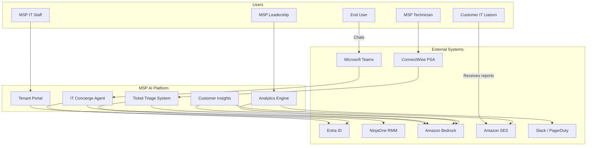
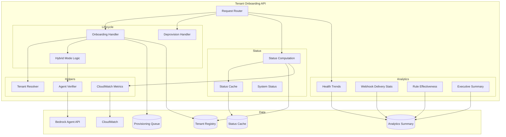
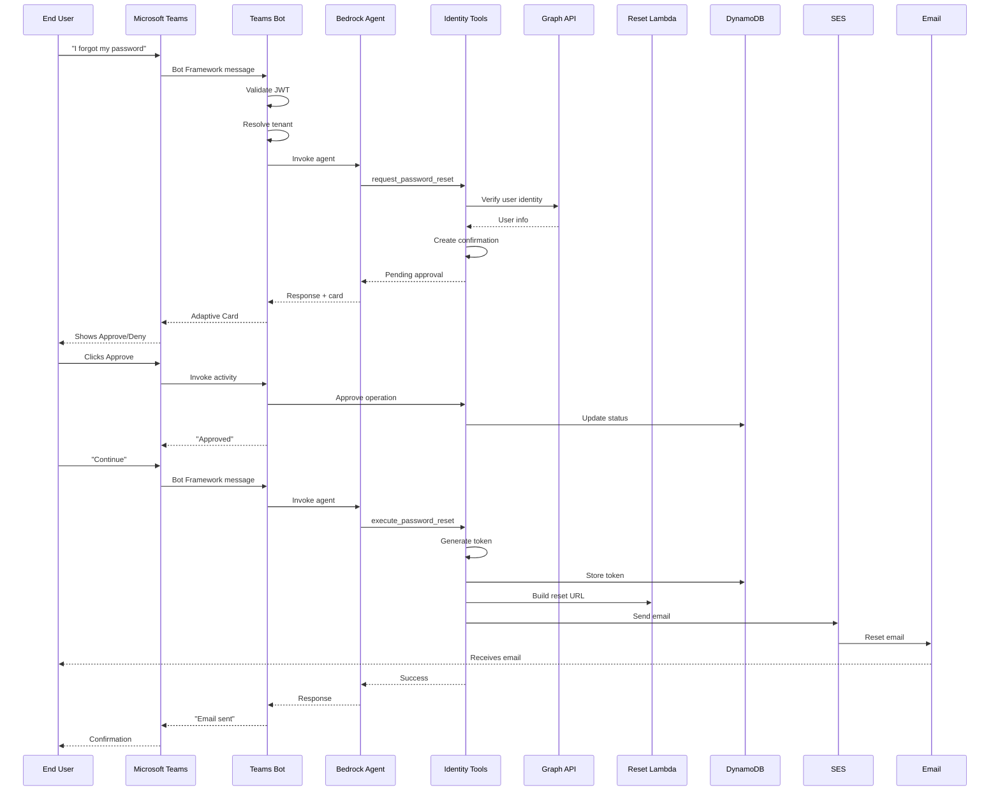
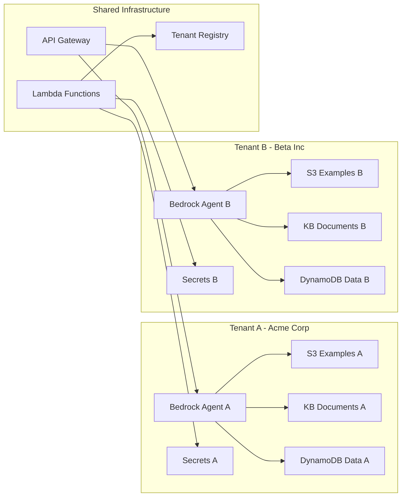

# MSP AI Platform - C4 Architecture (Mermaid)

These diagrams use Mermaid syntax and render directly in GitHub, GitLab, and most Markdown viewers.

## Level 1: System Context

## Level 2: Container Diagram

```mermaid
graph TB
    subgraph API Layer
        ONBOARDING_API[Tenant Onboarding API]
        RESET_API[Password Reset API]
        PORTAL_API[Portal API]
        WEBHOOK_API[Webhooks API]
    end
    
    subgraph AI Services
        TEAMS_BOT[Teams Bot Adapter]
        AGENTS[Per-Tenant Bedrock Agents]
        KB[Knowledge Base + AOSS]
    end
    
    subgraph Core Lambdas
        IDENTITY[Identity Tools]
        TICKETS[Ticket Tools]
        DEVICES[Device Tools]
        CALENDAR[Calendar Tools]
        TRIAGE_ORCH[Triage Orchestrator]
        TRIAGE_WORKER[Triage Worker]
    end
    
    subgraph Customer-Facing
        DIGEST_ORCH[Digest Orchestrator]
        DIGEST_WORKER[Digest Worker]
        INSIGHTS_ORCH[Insights Orchestrator]
        INSIGHTS_WORKER[Insights Worker]
    end
    
    subgraph Multi-Tenant
        PROV_WORKER[Provisioning Worker]
        STATUS_SNAP[Status Snapshot]
        WEBHOOK_NOTIF[Webhook Notifier]
        ANALYTICS_AGG[Analytics Aggregation]
    end
    
    subgraph Feedback Loops
        FB_COLLECTOR[Feedback Collector]
        FB_SYNC[Feedback Sync]
        AGENT_FB[Agent Feedback]
    end
    
    subgraph Data Stores
        DDB[(DynamoDB - 15 tables)]
        S3[(S3 - 5 buckets)]
        SQS[(SQS - 6 queues)]
        SM[(Secrets Manager)]
    end
    
    subgraph External
        TEAMS[Microsoft Teams]
        ENTRA[Entra ID]
        CW[ConnectWise]
        NINJA[NinjaOne]
        BEDROCK[Amazon Bedrock]
        SES[Amazon SES]
    end
    
    TEAMS --> TEAMS_BOT
    TEAMS_BOT --> AGENTS
    AGENTS --> BEDROCK
    AGENTS --> KB
    
    IDENTITY --> ENTRA
    TICKETS --> CW
    DEVICES --> NINJA
    CALENDAR --> ENTRA
    
    TRIAGE_ORCH --> SQS
    TRIAGE_WORKER --> BEDROCK
    
    DIGEST_WORKER --> BEDROCK
    DIGEST_WORKER --> SES
    INSIGHTS_WORKER --> BEDROCK
    INSIGHTS_WORKER --> SES
    
    FB_SYNC --> S3
    STATUS_SNAP --> DDB
    ANALYTICS_AGG --> DDB
    
    ONBOARDING_API --> SQS
    PROV_WORKER --> BEDROCK
    PROV_WORKER --> DDB
    
    TEAMS_BOT --> DDB
    TEAMS_BOT --> S3
    WEBHOOK_NOTIF --> DDB
```

## Level 3: Component - Tenant Onboarding API

## Data Flow: Password Reset

## Multi-Tenant Isolation

